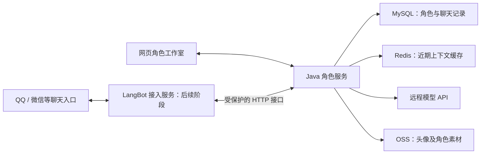

# 大枣角色智能体平台：总体方案

- 版本：V0.1
- 日期：2026-10-14
- 阶段：方向方案；本地首版已实施，具体完成范围见根目录 README 和首版详细设计
- 项目名称暂定，后续再确定正式名称和视觉品牌。

## 1. 产品方向

将大枣小站的主要产品入口转向角色创作与互动：用户描述自己想要的角色，系统生成可编辑的角色档案，用户确认后立即与角色聊天，后续可将角色绑定到 QQ、微信等聊天入口。

目录安排已按用户要求调整：新后端位于 E:/JavaWeb-java-items/dazao-project-ai/ 根目录，前端位于 frontend/，gpt/ 仅存放文档。旧工程及旧 Git 记录移入同级备份，详情见目录替换记录.json。首版不接入旧社区账号和数据，本次不更改云服务器。

总体路线：**自研角色创作和运行能力，复用开源项目的聊天平台接入能力。**

首先验证“生成的角色符合要求，而且用户愿意继续与它聊天”。产品围绕角色创建、调整和互动展开，论坛功能的去留在后续页面规划中决定。

支持的角色方向包括：

- 原创角色：根据用户给定的性格、背景、外观和互动要求补全设定。
- 已有动漫、游戏、小说等 IP 角色：明确作品、角色版本和参考资料，区分原作事实与用户改编。
- 功能型角色：具有鲜明人格的学习伙伴、创作伙伴或技术助手。

已有 IP 的准确还原取决于资料质量与模型表现。生成时保留用户指定的内容，对模型补全的设定允许用户确认和修改。

## 2. 首版产品闭环

首版优先完成网页中的角色创建与试聊：

**描述需求 → 生成角色 → 编辑与局部重生成 → 保存角色 → 开始聊天。**

| 能力 | 首版方向 |
| --- | --- |
| 角色生成 | 生成姓名、简介、背景、人格、表达方式、开场白和示例对白等角色档案 |
| 角色调整 | 支持手动编辑，锁定满意的字段，只重新生成需要修改的内容 |
| 我的角色 | 保存、查看、复制和删除自己创建的角色 |
| 角色试聊 | 根据选定角色回复，支持独立会话、流式输出及重新生成回复 |
| 数据保存 | 角色和聊天记录持久保存，用户更换浏览器后仍可继续使用 |
| 基础控制 | 角色访问权限、调用额度、超时与失败提示 |

角色档案包含外观描述。首版可以上传头像或使用默认头像，自动头像生成作为随后可加入的独立能力。网页是首版的验证入口，外部平台接入安排在角色体验通过验收后。

## 3. 核心实现思路

### 3.1 角色创建与角色运行分开

角色创建服务负责理解需求、生成结构化档案、校验字段，并把结果交给用户编辑确认。角色运行服务负责加载角色设定、必要的知识和会话上下文，调用模型完成互动。

角色以数据形式保存，多种角色共享模型调用基础设施。首版使用远程模型 API，通过角色设定控制表现，不为每个角色单独训练模型或创建独立运行容器。

用户指定的角色内容与平台运行规则分别管理；角色描述不能自动赋予工具执行权限。

### 3.2 先做好持久会话，再逐步完善记忆

MySQL 保存角色、角色版本、会话和完整聊天记录；Redis 用于近期上下文缓存等临时数据。角色版本与会话关联，避免修改人设后，历史聊天被无提示地切换到另一套设定。

记忆按用户、角色和会话隔离。外部平台接入后，再增加平台身份与会话绑定关系。跨角色、跨群聊共享记忆必须有明确的产品规则。

长期记忆、关系演化和自动知识提取在后续阶段验证，首版先保证记录可恢复、上下文可控、会话不混用。

### 3.3 角色数据兼容现有生态

内部角色数据结合本项目需求设计，同时预留 Character Card V2 的导入导出方向，便于与 SillyTavern、RisuAI 等生态交流角色资产。兼容范围在详细设计时确定，不要求首版支持所有扩展字段。

对于已有 IP 角色，后续参考 ChatHaruhi 的方法，使用角色设定和相关原作资料检索改善表现。角色知识与用户聊天记忆分别管理。

## 4. 技术架构与职责

沿用 **Vue 3 + Spring Boot / Java 17 + LangChain4j + MySQL + Redis + OSS**，以模块化单体作为首版后端形态。新增独立角色业务模块，复用合适的现有基础能力。

LangBot 作为后续聊天平台接入的优先验证方案，独立运行，通过受保护的接口连接 Java 角色服务。

Java 后端统一管理角色、权限、会话和记忆。接入服务负责平台鉴权、消息收发、身份映射、消息去重及回复格式转换；默认不另建一套与 Java 冲突的角色记忆。

LangBot 的具体接入方式、接口兼容性和运行资源，在接入阶段通过小规模验证确定。首先验证 QQ 官方机器人，再验证微信 ClawBot 单聊；普通微信群属于需要单独核实的接入场景。

## 5. 现有项目如何演进

| 现有部分 | 演进方向 |
| --- | --- |
| 用户与登录 | 复用账号基础，补充角色归属和角色访问权限 |
| 模型调用与流式回复 | 复用调用链路，将固定社区助手扩展为按角色加载设定 |
| Vue 前端 | 新建角色工作室的主要页面，复用适合的组件与请求基础设施 |
| MySQL、Redis、OSS | 继续使用，明确持久数据、缓存与素材的职责 |
| 社区论坛与私信 | 保留现有数据，后续确定入口与产品定位；角色业务独立组织 |
| 现有知识检索示例 | 当前未启用，后续依据角色知识需求选择实现 |

现有 Redis 对话记忆仅保留最近 10 条消息并缓存一天，前端会话列表主要保存于浏览器。因此，持久角色与持久聊天记录是本次新增业务的基础工作。

新功能先在本地开发验证，再安排预演和上线。涉及公用组件或底层框架较大调整时，先讨论具体范围。

## 6. 开源项目借鉴范围

| 项目 | 主要借鉴点 |
| --- | --- |
| [Tavern Card Crafter](https://github.com/Idun/tavern-card-crafter-v3) | AI 生成、角色编辑、预览与导出的创作流程 |
| [Character Creator](https://github.com/virgilianshailer/character-creator) | 根据描述生成角色、字段锁定和局部重生成 |
| [SillyTavern](https://github.com/SillyTavern/SillyTavern) | 角色设定、世界书和聊天上下文的组织方式 |
| [ChatHaruhi](https://github.com/LC1332/Chat-Haruhi-Suzumiya) | 使用角色设定及原作资料检索改善 IP 角色表现 |
| [LangBot](https://github.com/langbot-app/LangBot) | 多聊天平台适配器、消息流水线与接入管理 |
| [Character Card V2](https://github.com/malfoyslastname/character-card-spec-v2) | 角色资产交换格式 |

借鉴流程与职责划分，自研面向本产品的角色业务。实际采用代码、依赖或素材前，核对相应许可证；项目代码许可与角色图片、声音、模型素材的授权分别处理。

## 7. 阶段顺序与验收

| 阶段 | 交付重点 | 通过条件 |
| --- | --- | --- |
| 第一阶段：详细设计 | 页面流程、角色字段、会话与版本规则、模型调用方式 | 创建、修改、保存和聊天的行为定义清楚 |
| 第二阶段：网页 MVP | 角色生成、编辑、管理、试聊与持久记录 | 核心闭环可用，角色与用户数据正确隔离 |
| 第三阶段：角色质量完善 | 头像生成、知识补充、上下文策略与成本优化 | 生成与聊天质量达到设定的体验目标 |
| 第四阶段：聊天平台接入 | LangBot 与 Java 联调，QQ 官方机器人及微信单聊试点 | 消息收发、会话映射、重连、去重和异常处理通过验证 |
| 后续扩展 | 语音、动态形象、长期记忆、多角色互动、工具能力 | 根据实际使用反馈逐项确定优先级 |

首轮体验验收选择 5 个风格不同的角色，每个角色连续交流约 20 轮，重点检查：

- 生成结果是否符合用户明确提出的要求。
- 不同角色的表达与行为是否有明显差异。
- 连续聊天是否保持人格，是否出现明显设定矛盾。
- 锁定字段、局部重生成和角色修改是否按预期生效。
- 刷新页面或更换浏览器后，记录是否正确恢复。
- 不同用户、角色及会话之间是否出现数据或记忆混用。

## 8. 部署边界与后续待定事项

依据 2026-10-11 迁移记录，大枣已部署于腾讯云 `111.230.151.168`，同机 Saya 业务需要继续保持隔离。新服务使用独立容器、明确端口和资源限额；扩展部署前重新检查机器资源，不依据历史余量直接决定容量。现有 Compose 运维方式继续沿用。

本阶段不进行服务器变更。后续上线需要有大枣数据备份、预演与回退安排，Saya 的容器、数据库、凭据和网络不作为本项目的改造对象。

详细设计阶段再确定以下内容：

1. 正式产品名称、视觉风格与首页信息结构。
2. 原创角色和已有 IP 角色的创建交互、资料来源与展示方式。
3. 模型服务选择、生成质量、调用额度及成本预算。
4. 角色是否公开分享，以及编辑权限和角色版本规则。
5. 外部平台的账号资格、开通能力和角色绑定方式。
6. 具体模块、数据表、接口、部署拓扑和实施工作量。

本方案先确定产品定位、架构职责和实施顺序。下一步从第一阶段的详细设计开始，围绕“创建角色并立即试聊”推进。
